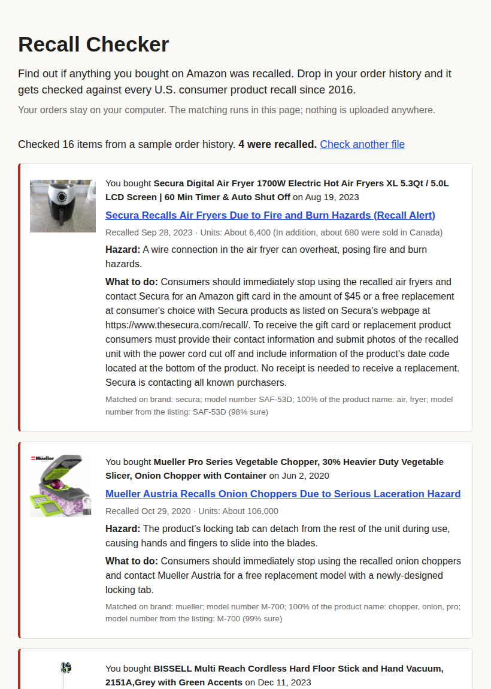

# Recall Checker

Drop in your Amazon order history and find out if anything you bought was recalled.

**Try it: [tejesh18.github.io/recall-checker](https://tejesh18.github.io/recall-checker/)** (there's a sample order history if you don't want to use yours)



## Why

Recalls are going up, and more of them are about things sold online:

| | CPSC recalls | mention Amazon |
|---|---|---|
| 2016 | 330 | 81 (25%) |
| 2020 | 257 | 74 (29%) |
| 2024 | 305 | 129 (42%) |
| 2025 | 420 | 219 (52%) |
| 2026 (to Nov 12) | 521 | 310 (60%) |

Every recall is posted on cpsc.gov, but nobody goes back to check whether the space heater they bought in 2023 is on the list. Retailers email some buyers, sometimes. Meanwhile everyone who shops on Amazon can download a full list of everything they ever bought. This puts the two lists side by side.

Your order history never leaves your browser. The recall list is downloaded once and the matching runs in the page.

## The hard part: matching

A recall says "Stainless King Food Jars, model SK3020". Amazon says "THERMOS Stainless King Vacuum-Insulated Food Jar, 24 Ounce, Midnight Blue". Same product. Meanwhile "THERMOS FUNTAINER Kids Straw Bottle" shares the brand and isn't recalled, and "Replacement Charger for BISSELL Multi Reach 2151A" has the recalled vacuum's name *and* model number and isn't the vacuum.

To measure this I needed real Amazon titles, so I streamed 5M listings from the [Amazon Reviews 2023](https://amazon-reviews-2023.github.io/) catalog, pulled out the 5,571 that could plausibly be a recalled product, and labeled 350 listing/recall pairs (rules in [labels/LABELING.md](labels/LABELING.md)). I also kept 2,000 random listings to count false alarms on everyday products.

| | precision | recall | random listings flagged |
|---|---|---|---|
| brand + any shared word | .18 | .98 | 373 / 2000 |
| rules (brand position, word rarity, accessories) | .87 | .75 | 0 / 2000 |
| logistic regression on the rule features, cutoff .9 | 1.00 | .64 | 0 / 2000 |
| same, title only (no model number) | 1.00 | .38 | 0 / 2000 |

The learned rows are 5-fold cross-validated. Everything is scored per listing (a listing only counts as caught if the *right* recall comes back).

What made the difference:

- **Brand isn't enough.** The first version flagged one in five ordinary products. Brands like "Comfort" or "Home" are everyday words, and half of Amazon has a brand that recalled *something*. Now the brand has to be in the first six words of the title (where Amazon puts it), a one-word brand that's also a common word counts for less, and the title needs most of the recalled product's distinctive words.
- **Word weights come from Amazon, not the recalls.** How rare a word is across ordinary listings says how much it identifies a product. "Christmas" or "digital" matching means nothing; "chopper" and "mulcher" mean a lot.
- **Accessories.** Chargers, sheets, covers and refills carry the parent product's name. A title that's clearly *for* something is skipped unless the recall itself is about that accessory. ("Leaf blower kit with bag" is still a leaf blower.)
- **Order exports don't have model numbers.** The catalog has a model number field; the order export only has the title. That drops recall from .64 to .38. Training on title-only examples made it worse, not better. What did help: the export has the ASIN, so for 3,050 listings from recalled brands the site looks up the model number from the catalog.

Honestly, the logistic regression didn't beat a well-tuned rule threshold by much. I kept it because it gives a probability, and that's what splits results into "recalled" (≥ .9) and "worth a second look" (≥ .5, compare the model number yourself).

## How it runs

```
cpsc.gov API ──► recalls.build ──► recalls.export ──► index.json ──► browser
                 (every recall      (brands, product                  your order history
                  since 2016)        word sets, model                 + matcher.ts
                                     numbers, weights)
```

- `src/recalls/` (Python): fetching recalls, the matcher, evaluation, training, export.
- `web/` (React + TypeScript): the site. `lib/matcher.ts` is a port of `match.py`; a test checks it gives the same answer as the Python version on 649 titles.
- The deploy workflow rebuilds the recall list from cpsc.gov every morning and redeploys, so new recalls show up without a commit.

## Running it

```bash
uv run python -m recalls.build --since 2016   # ~3,400 CPSC recalls into data/
uv run python -m recalls.export               # web/public/index.json
cd web && npm install && npm run dev
```

Tests: `uv run --group dev pytest` and `cd web && npm test`.

Re-running the evaluation needs the Amazon sample (`scripts/amazon_candidates.py` streams it), then `python -m recalls.evaluate` and `python -m recalls.learned`.

## Limits

- CPSC only: toys, appliances, furniture, baby gear, electronics. Food, drugs and cars (FDA, NHTSA) aren't matched yet.
- A clean result means nothing obvious matched, not that nothing you own is recalled. If the title doesn't describe the product the way the recall does, it gets missed.
- 350 labeled pairs is enough to compare approaches, not to promise exact numbers.
